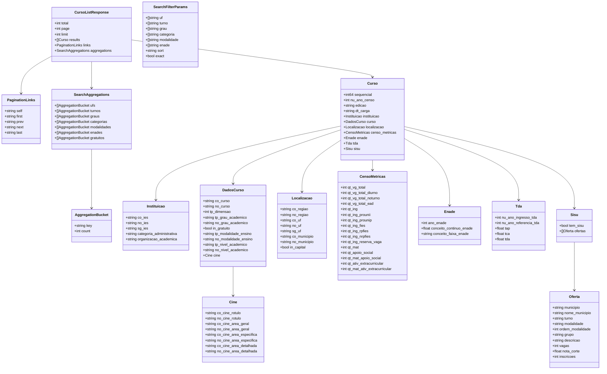

# API — Cursos e IES

API HTTP **somente leitura** (Go), sobre o Elasticsearch. Código em
`packages/api`; modelos em `internal/features/*/model*.go`.

## Convenções

Valem para todos os endpoints.

| Tema | Comportamento |
| :--- | :--- |
| Métodos | Só `GET` (e `OPTIONS` para CORS). Outro método em rota existente devolve `405`. |
| Erros | Corpo JSON `{"error": "mensagem"}`. |
| `page` | Inteiro ≥ 1. Ausente, inválido ou < 1 vira `1`. |
| `limit` | Inteiro de 1 a 100 (padrão `20`). **Fora dessa faixa não é limitado a 100: volta ao padrão `20`.** Em sugestões a regra é outra (ver [Sugestões](#sugestões-de-nomes)). |
| Filtros multivalorados | Aceitam repetição (`uf=SP&uf=RJ`) ou vírgula (`uf=SP,RJ`). |
| Paginação | A resposta traz `links` (`self`, `first`, `prev`, `next`, `last`) com os filtros preservados (inclusive `exact=false` em cursos). `prev`/`next` são omitidos nas pontas. |
| Agregações | Buckets do tipo `filters` (`categorias`, `turnos`) vêm ordenados por contagem decrescente e, em empate, pela chave. |
| Timeout | 5 s por requisição; estourar o prazo vira `500`. |
| CORS | `Access-Control-Allow-Origin: *`; métodos `GET, OPTIONS`; headers `Content-Type, Authorization`. `OPTIONS` responde `200`. |
| `X-Request-Id` | Reaproveitado da requisição ou gerado; devolvido no header de resposta e presente no log de acesso. |

Códigos comuns: `200` sucesso, `400` parâmetro obrigatório ausente ou inválido,
`404` recurso inexistente (endpoints de detalhe), `405` método não permitido,
`500` falha no Elasticsearch ou erro interno (a mensagem do Elasticsearch não
é exposta).

### `GET /healthz`

Liveness da API: responde `200 {"status": "ok"}`. **Não consulta o
Elasticsearch.**

## Módulo de Cursos

### Modelagem de Dados (`model.go`)

Campos numéricos e de data são ponteiros e `omitempty` no código: podem
vir ausentes (`nil`) no JSON. O diagrama mostra só os tipos base.

#### Diagrama de Classes e Estruturas

---

### Endpoints

#### `GET /cursos`

Busca textual paginada de cursos, com filtros e agregações.

| Parâmetro | Tipo | Obrigatório | Padrão | Descrição |
| :--- | :--- | :--- | :--- | :--- |
| `q` | `string` | **Sim** | — | Termo de busca (ex.: `medicina`). Ausente ou em branco devolve `400`. |
| `page` | `int` | Não | `1` | Ver [Convenções](#convenções). |
| `limit` | `int` | Não | `20` | Ver [Convenções](#convenções). |
| `exact` | `bool` | Não | `true` | Com `true`, se existir um curso cujo nome seja **exatamente** `q` (ignora caixa e acentos), a busca retorna só esses, sem nomes parecidos. Com `false`, busca textual normal. Valor ausente ou inválido vale `true`. Cada busca com `exact=true` faz uma consulta extra ao Elasticsearch. |
| `uf` | `string` / `[]string` | Não | — | Sigla da UF; convertida para maiúsculas (`uf=sp` funciona). |
| `turno` | `string` / `[]string` | Não | — | `diurno`, `noturno`, `integral` ou `ead` (sem diferenciar caixa). Outros valores não são suportados (efeito não verificado). |
| `grau` | `string` / `[]string` | Não | — | Rótulo exato do grau, **com caixa**: `Bacharelado`, `Licenciatura`, `Tecnológico`. `bacharelado` em minúsculas não casa. |
| `categoria` | `string` / `[]string` | Não | — | `privada`, `federal`, `estadual` ou `municipal` (sem diferenciar caixa). Traduzida para a categoria administrativa da IES (`privada` inclui com e sem fins lucrativos). Valor desconhecido é ignorado. |
| `modalidade` | `string` / `[]string` | Não | — | `EaD` (ou qualquer texto com "distância") filtra educação a distância; qualquer outro valor filtra presencial. |
| `enade` | `string` / `[]string` | Não | — | Faixa do conceito Enade (`1` a `5`), valor exato do campo `conceito_faixa_enade`. |
| `sort` | `string` | Não | `_score` | `enade` (conceito contínuo, maior primeiro), `desistencia` (menor `tda` primeiro), `az` (nome do curso). Vazio, `_score` ou `relevancia` usam relevância. **Qualquer outro valor devolve `400`.** |

Filtros diferentes se combinam com **E**; valores do mesmo filtro com **OU**.

Resposta `200`: `CursoListResponse` com `total`, `page`, `limit`, `results`,
`links` e `aggregations` (`ufs`, `turnos`, `graus`, `categorias`,
`modalidades`, `enades`, `gratuitos`).

> Atenção: a regra do filtro `turno=integral` (e parte de `diurno`/`noturno`)
> depende de `sisu.ofertas.turno`, que é `nested` no mapping. Há suspeita de que
> essas cláusulas não casem; ver [analise-sonnet.md](analise-sonnet.md), seção 9.
> Não verificado contra um Elasticsearch real.

#### `GET /cursos/{id}`

Retorna um curso pelo `_id` do documento no índice `cursos` (o `sequencial`).

- **`200`**: objeto `Curso`.
- **`404`**: `{"error": "Curso não encontrado"}`.
- **`400`**: `id` vazio ou não numérico.

#### `GET /cursos/sugestoes`

Autocomplete de nomes de curso. Ver [Sugestões](#sugestões-de-nomes).

---

## Módulo de IES

### Modelo (`IES`)

O documento da IES é plano (sem nested) e vive no índice `ies`, cujo `_id` é o
próprio `co_ies`.

| Campo | Tipo | Descrição |
| :--- | :--- | :--- |
| `co_ies` | `string` | Código (keyword) da IES |
| `no_ies` | `string` | Nome da IES |
| `sg_ies` | `string` | Sigla da IES |
| `categoria_administrativa` | `string` | Ex.: `Pública Federal`, `Privada com fins lucrativos` |
| `organizacao_academica` | `string` | Ex.: `Universidade`, `Centro Universitário`, `Faculdade` |
| `municipio` | `string` | Município sede |
| `uf` | `string` | Sigla da UF |
| `regiao` | `string` | Ex.: `Sudeste`, `Norte` |

### Endpoints

#### `GET /ies`

Busca paginada de IES por nome ou sigla. **`q` é obrigatório**: sem ele a API
responde `400` (não existe listagem de todas as IES).

| Parâmetro | Tipo | Obrigatório | Padrão | Descrição |
| :--- | :--- | :--- | :--- | :--- |
| `q` | `string` | **Sim** | — | Termo de busca em nome (peso 3) e sigla (peso 2) |
| `page` | `int` | Não | `1` | Ver [Convenções](#convenções) |
| `limit` | `int` | Não | `20` | Ver [Convenções](#convenções) |
| `uf` | `string` / `[]string` | Não | — | Ex.: `uf=SP` ou `uf=SP,RJ` |
| `regiao` | `string` / `[]string` | Não | — | Ex.: `regiao=Sudeste` |
| `categoria` | `string` / `[]string` | Não | — | `privada`, `federal`, `estadual`, `municipal` |
| `organizacao` | `string` / `[]string` | Não | — | Ex.: `Universidade`, `Faculdade` |
| `sort` | `string` | Não | `az` | `az` (alfabético, também o valor vazio) ou `relevancia` (também aceita `_score`). **Outro valor devolve `400`.** |

Resposta `200`: `IESListResponse` (`total`, `page`, `limit`, `results`,
`links`, `aggregations`). Agregações: `ufs`, `regioes`, `categorias`,
`organizacoes`.

#### `GET /ies/{co_ies}`

Retorna os dados cadastrais de uma IES pelo seu `co_ies`.

- **`200`**: objeto `IES`.
- **`404`**: `{"error": "IES não encontrada"}`.
- **`400`**: `co_ies` vazio ou com caracteres fora de letras, dígitos, `_` e `-`.

#### `GET /ies/sugestoes`

Autocomplete de nomes de IES. Ver [Sugestões](#sugestões-de-nomes).

---

## Sugestões de nomes

`GET /cursos/sugestoes` (índice `dicionario_cursos`) e `GET /ies/sugestoes`
(índice `dicionario_ies`) compartilham o mesmo comportamento.

| Parâmetro | Tipo | Obrigatório | Padrão | Descrição |
| :--- | :--- | :--- | :--- | :--- |
| `q` | `string` | **Sim** | — | Trecho do nome. Ausente ou em branco devolve `400`. Com menos de 2 caracteres devolve `200` com lista vazia, sem consultar o índice. |
| `limit` | `int` | Não | `8` | Máximo de sugestões. Menor que 1 vira `8`; **maior que 20 é limitado a 20**. |

Resposta `200`: `{ "results": ["..."] }` (sempre uma lista, nunca `null`).

> As rotas `/cursos/sugestoes` e `/ies/sugestoes` são literais e têm precedência
> sobre `/cursos/{id}` e `/ies/{co_ies}`.
